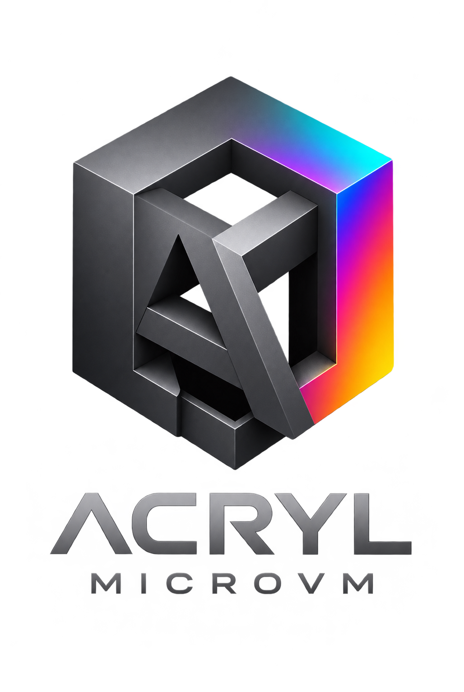
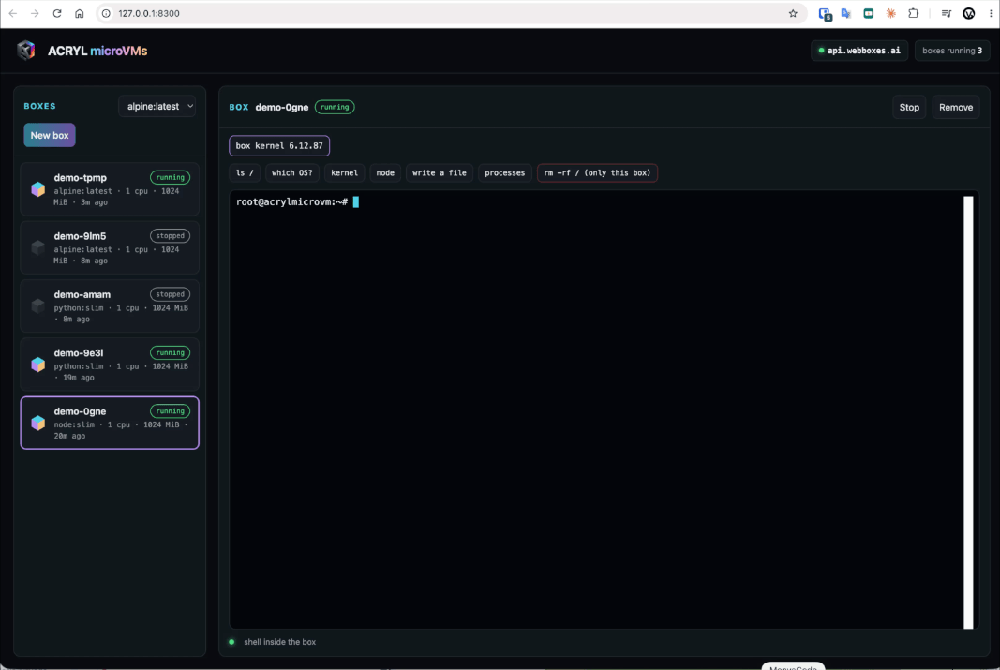

<p align="center">
  
</p>

# ACRYL microVMs

Hardware-isolated micro-VMs for running code you do not trust, built to be embedded in your own application.

Each **box** is a small virtual machine with its own kernel. It starts from a regular OCI image, keeps its disk
between runs, and can be snapshotted, cloned and exported. The engine is a library: your program links it and
starts boxes directly, with no daemon and no root. A REST server and a command line are included for the cases
where you want one.

<p align="center">
  <a href="https://www.youtube.com/watch?v=hg815xA5614">
    
  </a>
  <br>
  <sub>The <a href="examples/dashboard">example dashboard</a> with a shell inside a running box. <a href="https://www.youtube.com/watch?v=hg815xA5614">Watch the full demo on YouTube.</a></sub>
</p>

> **Status: work in progress.** Early releases; APIs can still change between versions. The Python SDK and the
> box images are not published under the new name yet.

## What you get

- **A kernel per box.** Code in a box runs in a guest VM under KVM (Linux) or Hypervisor.framework (macOS), not as
  a process on the host. The host-side helper process is itself sandboxed: namespaces, a chroot, a seccomp filter
  and cgroups v2 on Linux, a Seatbelt profile on macOS.
- **Any OCI image.** Boxes start from the images you already use, such as `python:slim` or `alpine:latest`.
- **State that stays.** A box keeps its disk across stops and restarts. Snapshots, `clone_box` and
  export/import let you branch a box or move it.
- **Egress you control.** Network access is off or on per box, with an `allow_net` list of hosts the guest may reach.
- **Secrets outside the guest.** A secret is bound to hosts and request headers. The host-side proxy writes the
  real value into matching requests; the guest only ever holds a placeholder. Bind a secret to hosts you trust:
  a server that echoes the header back would return the value.
- **SDKs.** Python, Node.js, Go, Rust and a C API, all on the same engine.
- **Three ways to run it.** As a library in your process, as the `acrylmicrovm` command line, or as a REST service
  (`acrylmicrovm serve`).

## Supported platforms

| OS                   | CPU           | Requirement                          |
| -------------------- | ------------- | ------------------------------------ |
| macOS                | Apple Silicon | macOS 12 or newer                    |
| Linux                | x86_64, ARM64 | KVM enabled, `/dev/kvm` accessible   |
| Windows (under WSL2) | x86_64        | WSL2 with KVM support                |

Intel Macs are not supported.

## Install

```console
npx acrylmicrovm run --rm alpine:latest echo hello   # the command, prebuilt, from npm
cargo install acrylmicrovm-cli                        # the same command, built from crates.io
npm i acrylmicrovm                                    # the Node SDK
cargo add acrylmicrovm                                # the Rust library
```

Linux (x86_64, arm64) needs read and write access to `/dev/kvm`; macOS needs Apple Silicon. Prebuilt binaries are
also on the [releases page](https://github.com/acryldev/acrylmicrovm/releases).

## A first box

Python:

```python
import asyncio
import acrylmicrovm

async def main():
    async with acrylmicrovm.SimpleBox(image="python:slim") as box:
        result = await box.exec("python", "-c", "print('hello from a box')")
        print(result.stdout)

asyncio.run(main())
```

Command line:

```console
acrylmicrovm run python:slim python -c 'print("hello from a box")'
```

Guides for each language are in [`docs/getting-started`](./docs/getting-started/README.md); runnable examples are in
[`examples/`](./examples) and [`sdks/`](./sdks).

## Repository layout

| Path                  | What is in it                                                                  |
| --------------------- | ------------------------------------------------------------------------------ |
| `src/acrylmicrovm`    | The embeddable runtime library                                                 |
| `src/cli`             | The `acrylmicrovm` command line and the REST server                            |
| `src/guest`, `src/shim` | The agent inside the VM, and the sandboxed host helper that runs each VM     |
| `src/hypervisor`, `src/vmm` | The VM monitor and its device layer                                      |
| `sdks/`               | Python, Node.js, Go and C bindings                                             |
| `docs/`               | Concepts, guides, reference and contributor documentation                      |
| `apps/`               | Generated REST clients, end-to-end tests and local support services           |

## Contributing

Read [`CONTRIBUTING.md`](./CONTRIBUTING.md) first, and [`SECURITY.md`](./SECURITY.md) for reporting a vulnerability.

## License and notices

This work is derived from a project licensed under the Apache License, Version 2.0. The licence is in
[`LICENSE`](./LICENSE); attribution, a statement of changes and the licences of third-party parts of this tree are
in [`NOTICE`](./NOTICE). A few files carry their own licence identifiers and keep them.
